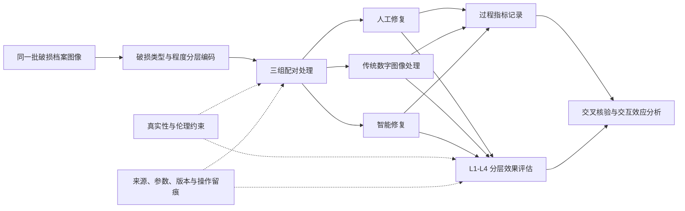
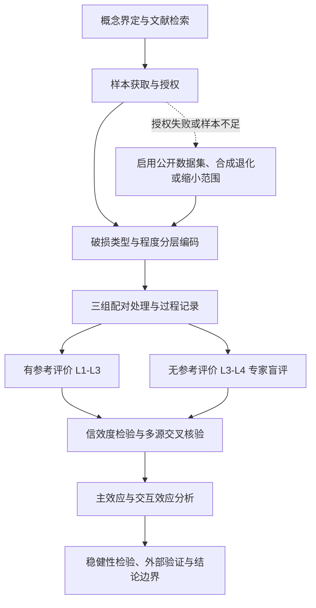

[README.md](https://github.com/user-attachments/files/35441605/README.md)

# 档案图像修复中人工、MATLAB数字处理与AI方法的比较研究——基于过程指标与分层效果评估的视角

## 摘要

档案图像修复正在形成三条并行的技术路线：以修复师经验为基础的人工修复、以传统数字图像处理算法为基础的工具辅助修复，以及以深度学习模型为基础的智能修复。既有讨论多集中于单一方法的效果展示或算法指标提升，缺少在同一批样本、同一套评价口径下对三类路线的**过程代价**与**结果质量**同时进行的比较。更关键的是，PSNR、SSIM 等像素级指标并不天然等价于档案工作所要求的真实性、完整性与最小干预，生成式修复甚至可能在指标改善的同时补绘出原本不存在的笔画。由此产生的问题是：**"修得好"由谁定义，以及"修得好"是否仍然"可作为档案凭证"**。

本研究以同一批破损档案图像的配对实验为基础，从档案学与文档图像处理的交叉视角出发，将三条路线统一界定为"人工修复／传统数字图像处理（基于 MATLAB 实现）／智能修复（基于深度学习模型）"，构建"**过程指标—四层效果评估**"的双维比较框架：过程维度记录工时、操作步骤、技能门槛、成本与可重复性；效果维度按 L1 像素与信号层、L2 二值化与结构层、L3 可读性与任务层、L4 档案价值层逐级评估，其中 L4 以专家双人独立盲评考察真实性、完整性与最小干预。研究采用配对实验、结构化指标测量、专家盲评与统计检验，区分"有参考评价"与"无参考评价"两条通道，并预设样本不足、授权受限等情形下的替代方案。

本文件为论文框架与研究方案，指标体系、样本配置、待检验命题与替代路径均属拟开展的研究设计，不构成实证结论。文中引用的公开数据集与指标信息已做初步核对，核对状态与著录、补充要求见文末"引注核对提示"。

**关键词：** 档案图像修复；人工修复；数字图像处理；生成式人工智能；过程指标；分层效果评估；档案真实性；配对实验

---

## 一、研究缘起与问题提出

### 1.1 现实背景：三条路线并存，但缺少同一口径的比较

档案数字化使破损图像的修复从馆藏库房延伸到数字工作流。透印、污渍、笔画褪色、背景纹理、模糊与折痕等退化类型，分别可由人工判别、显式算法规则或数据驱动模型处理。三条路线在决策依据、资源投入与输出性质上差异显著，却很少被置于同一比较框架内：算法研究多以 PSNR、F-measure 等指标报告单一模型的提升，档案业务研究多讨论修复原则与操作规范，二者之间缺少"同一批样本上的横向对照"。

由此形成两处脱节：一是**只比结果不比代价**，工时、技能门槛、可重复性等决定能否落地的因素未进入评价；二是**只比视觉不比凭证价值**，指标改善被默认等同于修复有效，而档案学立场要求追问输出是否仍可追溯、是否改变了原始信息。

### 1.2 核心矛盾：视觉质量、业务成本与档案真实性目标不一致

| 关联主体或活动 | 主要诉求 | 可能产生的冲突 |
| --- | --- | --- |
| 人工修复师 | 遵循最小干预、可逆性，保留原始信息 | 判断可靠但工时长、产能低，效果随个人经验波动 |
| 传统数字图像处理 | 参数可控、可复现、无需训练数据 | 对透印、笔画缺失等复杂退化能力有限；阈值法易致笔画断裂 |
| 智能修复（生成式） | 视觉质量与感知指标提升显著 | 可能生成原图不存在的笔画纹理，与真实性、完整性原则冲突；依赖算力与训练数据 |
| 档案保管与利用部门 | 可读性、长期保存、凭证价值 | 指标提升不等于凭证价值保障；处理过程若不留痕则难以回溯 |
| 评价与审稿环节 | 结论可比、可复核 | 像素指标与专家可读性判断可能背离，单一指标难以支撑结论 |

本研究以"**在同一批破损档案图像上，三类路线在过程代价与分层效果上各处于什么位置，以及在何种破损条件下应优先选择哪一类路线**"为总问题，并区分四个层次："能不能修""修得多快、多贵""修得好不好""修完还能否作为档案凭证"。

### 1.3 研究边界与区别

- 研究对象限定为**历史文档类档案图像**（含手写与印刷文字），结论不外推到照片、胶片、舆图等其他载体。
- 题目保留"MATLAB"表述，但正文中统一界定为"传统数字图像处理（基于 MATLAB 实现）"；MATLAB 是实现平台，不是方法类别。
- 不训练新模型、不追求算法创新，本研究定位为**方法比较与应用评估**，创新点在评价体系与比较设计。
- 结论限定于所用样本、破损类型与指标体系，不作"某方法普遍更优"的因果推断。
- 与一般图像复原研究相比，增加过程成本与档案价值两个维度；与一般档案修复规范研究相比，采用可量化的配对实证设计，而非仅作原则性讨论。

## 二、研究目标、研究问题与理论定位

### 2.1 研究目标

1. 统一界定三类修复路线的分类依据与操作边界，消除"操作主体／工具平台／技术范式"混用造成的比较基准混乱。
2. 建立可操作化的过程指标体系，给出各指标的测量定义、采集方式与一致性检验方案。
3. 构建 L1–L4 分层效果评估体系，明确各层指标、参考标准与适用条件，把档案真实性设为独立层级。
4. 在同一批配对样本上实施三类方法比较，检验"方法 × 破损类型／程度"的交互效应。
5. 形成面向档案业务场景的路线选择建议、结论边界声明与可复核的实验材料。

### 2.2 核心研究问题

| 编号 | 研究问题 | 重点分析对象 | 对应研究任务 |
| --- | --- | --- | --- |
| RQ1（可比性） | 三类路线如何在同一逻辑层级上被界定，配对实验如何保证输入、目标与评判口径一致？ | 概念边界、实验控制、盲法 | 概念界定与实验设计 |
| RQ2（过程） | 三类路线在工时、步骤、技能门槛、成本与可重复性上有何差异，差异随破损程度如何变化？ | 操作日志、工时台账、重复样本 | 过程指标测量 |
| RQ3（效果） | 三类路线在 L1–L4 各层的表现是否一致；出现"低层指标改善而 L4 真实性下降"时如何解释？ | 各层指标、专家盲评、背离个案 | 分层评估与交叉核验 |
| RQ4（条件） | 破损类型与程度是否调节方法效果，能否给出分场景的路线选择边界？ | 分层样本、交互效应、稳健性 | 统计检验与条件化结论 |
| RQ5（规范） | AI 生成式修复的幻觉性失真如何在评价体系中被识别、记录与约束？ | 生成版本留痕、内容标识、L4 | 评价规则与伦理边界 |

### 2.3 核心概念

- **档案图像修复：** 针对退化档案图像，为恢复其可读性与信息完整性而进行的处理活动；其评价须同时服从图像质量目标与档案真实性要求。
- **人工修复：** 由修复师依据经验与修复原则完成判断与处理，决策主体是人。
- **传统数字图像处理（基于 MATLAB 实现）：** 由人工设定显式规则与参数完成处理，如 Sauvola／Wolf／Niblack／Bernsen 局部阈值、CLAHE、形态学运算、维纳或 Richardson-Lucy 去模糊，决策主体是可陈述的算法规则。
- **智能修复（基于深度学习模型）：** 由训练所得模型隐式生成输出，如 U-Net、GAN、Transformer 类模型，决策主体是数据驱动的模型参数。
- **分类依据：** 三者的划分标准是"**决策依据的来源**"（经验／显式规则／数据驱动），既非软件名称，也非是否使用计算机。题目不改，但摘要与正文首次出现处须补足这一界定，否则易被质疑比较基准混乱。
- **过程指标：** 描述修复实施代价的可观测量，包括工时、步骤、技能门槛、成本、可重复性与返工率。
- **分层效果评估：** 按 L1–L4 四个层级分别评价修复结果，各层结论不合并为单一总分。
- **有参考评价／无参考评价：** 前者以 ground truth 为参照计算 L1／L2 指标，后者在缺少清晰原稿时以 L3 可读性与 L4 专家判断为主，两条通道分离报告。
- **幻觉性失真：** 生成式模型补绘出原图不存在的笔画、纹理或字符，导致视觉质量提升而原始信息被改变的现象。

### 2.4 理论基础与分析关系

| 理论视角 | 核心概念 | 在本研究中的具体用途 |
| --- | --- | --- |
| 档案真实性与来源原则 | 原始性、可追溯性、最小干预、可逆性 | 构成 L4 指标来源；要求处理过程留痕、生成结果标识 |
| 档案价值鉴定 | 凭证价值、保存价值、可读性 | 为 L3 与 L4 提供效标，说明指标为何不能止于像素层 |
| 图像质量评价 | 保真度、结构相似、感知质量 | 提供 L1–L3 指标池，并界定其与档案可用性的落差 |
| 实验设计与测量信效度 | 配对、盲评、评分者一致性、效标关联效度 | 保证三组比较的公平性与结论可复核 |
| 成本与可重复性分析 | 工时、技能门槛、组内相关 | 为过程指标提供测量与统计口径 |

研究的基本分析链条为：

本研究重点解释**过程代价与分层效果之间的对应关系**，以及低层指标与 L4 档案价值判断发生背离的条件。

## 三、研究现状、方法基础与研究切入点

### 3.1 文献梳理的四条脉络

第一，文档图像增强与退化类型研究按背景纹理、污渍、褪色、光照不均、水印、模糊六类退化归纳模型，并系统整理公开数据集与常用指标[1]。第二，深度学习文档图像增强综述梳理 GAN、U-Net、残差学习等路线，并说明真实配对数据难以获取使合成退化流程成为领域通行做法[2]。第三，面向历史文档的二值化研究提供 PHIBD、SMADI、Bickley Diary 等具馆藏来源的数据集说明及 FM、p-FM、PSNR、DRD 等指标定义[3]。第四，历史文档去噪的生成式方法以注意力 GAN 处理背景噪声并报告视觉质量改善[4]；近期混合方法研究把 F-measure、ME、NPM、PSNR、SSIM 等指标与轻度／重度两级退化实验设计结合，为分层指标与分级实验设计提供范例[5]。

既有研究提供了成熟的算法与指标工具，但有三处尚未衔接：评价指标以像素与感知质量为主，未把档案真实性与最小干预纳入评价层级；比较多在算法之间展开，缺少把人工修复作为独立对照组并同步记录过程代价的设计；各层指标可能相互背离，缺少明确的交叉核验规则。相关"研究不足"的判断将通过正式文献检索加以检验，不在框架阶段预设学术空白已被证明。

### 3.2 可用数据集与评价规范依据

| 依据类别 | 代表资源或指标 | 本研究用途 | 解释边界 |
| --- | --- | --- | --- |
| 公开基准数据集[1][3] | DIBCO／H-DIBCO 系列（DIBCO 2009／2011／2013／2017／2019 与 H-DIBCO 2010／2012／2014／2016／2018，历届测试图合计 136 幅并附 ground truth，覆盖严重破损、透印、污渍、笔画褪色、背景纹理）；SMADI（30 封 17—20 世纪铁胆墨水手写信，240 幅多光谱图像，原件藏魁北克国家图书馆与档案馆）；PHIBD（15 幅波斯历史手稿）；Bickley Diary（光照与折痕损伤） | 有参考评价主渠道、分层抽样框 | 主要面向二值化与去噪，破损类型覆盖有限；以西文与波斯文为主 |
| 中文文档图像集[1] | DocImgCN（CNKI 文献转中文文档图像，23 万训练／1 万验证／1 万测试） | 中文样本与跨数据集稳健性检验 | 由当代文献生成，历史档案属性弱 |
| 真实馆藏与业务图像 | Tobacco800、SmartDoc-QA、合作档案馆授权图像及历史修复记录 | 外部验证、档案属性补强 | 需授权谈判；多数无 ground truth |
| 常用指标[1][3] | FM、p-FM、DRD、PSNR、SSIM、ME、NPM、CER／WER | L1–L3 指标池 | 像素指标不等价于档案可读性；DIBCO 数据集不提供 OCR 输出[3]，CER／WER 须自行跑 OCR 获得；LPIPS 为拟补充的感知质量指标，适用性须在预实验中检验 |
| 合成退化依据[2] | 在清晰图像上程序化叠加模糊、噪声、透印、污渍、褪色 | 无参考通道与配对样本构建 | 与真实退化存在域差距，须在讨论中声明 |

**表述精度提示：** DIBCO 系列由 ICDAR／ICFHR 系列二值化竞赛发布，[1]记载其中历史文档源自 READ 项目（Recognition and Enrichment of Archival Documents）。答辩时应表述为"据[1]，所含历史文档源自 READ 项目"，不宜说成"DIBCO 数据集由 READ 项目建立"；后者与竞赛官方说明不一致。这一区分直接关系到"所用数据是否属于档案图像"的追问能否站得住。

### 3.3 研究切入点：为什么必须走实证比较路径

判断由选题的三个内在规定性决定，而非凭直觉：

**第一，核心命题是"比较"，比较必须建立在实证结果之上。** 没有同一批图像上的实际操作与可比对结果，"比较"即退化为方法介绍罗列，无法回答"谁更优、在什么条件下更优"。

**第二，副标题中的两个视角本身就是测量概念。** 过程指标需记录耗时、步骤数、技能门槛、成本、一致性等可观测量；分层效果评估需对结果按层级量化评分。二者都须通过实验观测与指标映射获得，不能由思辨推出。

**第三，档案修复属应用研究，天然排斥纯理论定位。** 若定位为理论型研究，三类方法比较便失去载体；除非彻底改题为"方法比较的理论框架研究"，否则理论路径不成立。

> **反面论证：** 假设强行走理论路径，以文献溯源与典型案例作为补偿，最多得到"三类方法各有优劣"的常识性结论，无法支撑副标题承诺的"过程指标与分层效果评估"。因此该路径与目标题目不兼容。

切入方式上，不把"哪类方法更好"作为单一判断题，而采用 **方法 × 破损类型 × 破损程度 × 评价层级** 的条件化分析，分别讨论不同组合下的表现与风险。

## 四、研究内容与分析框架

### 4.1 三类路线的统一界定与配对可比性设计

| 技术路线 | 决策依据 | 拟采用的实现 | 过程记录要点 | 主要可控性风险 |
| --- | --- | --- | --- | --- |
| 人工修复 | 修复师经验与修复原则 | 按最小干预原则在图像编辑软件中完成判别与调整 | 工时、操作步骤、返工记录 | 操作者内与操作者间差异 |
| 传统数字图像处理 | 显式规则与人工设定参数 | MATLAB 实现 Sauvola／Wolf／Niblack／Bernsen 阈值、CLAHE、形态学、维纳或 Richardson-Lucy 去模糊 | 参数、运行时间、脚本版本 | 针对测试集反复调参带来的不公平优势 |
| 智能修复 | 数据驱动的模型参数 | U-Net／GAN／Transformer 类代表模型，以预实验可复现者为准 | 模型与权重来源、训练／测试隔离、推理耗时与硬件 | 训练与测试数据重叠、预训练语料泄漏 |

**公平性控制四条：** ① 同一输入图像、同一输出规格（尺寸、色彩空间、文件格式）、同一评价口径；② 人工组与算法组均不接触 ground truth 及彼此结果；③ 参数、脚本与模型版本全程留痕，算法参数在预实验阶段固定；④ 盲评时隐去方法标签并随机化呈现顺序。AI 组须使用公开权重或本地训练，并报告训练／测试隔离方式。

### 4.2 过程指标体系

| 维度 | 观察项 | 操作化定义 | 采集方式 |
| --- | --- | --- | --- |
| P1 时间 | 单幅净工时 | 从接收图像到提交成品的净操作时长，不含等待与交付 | 计时加操作日志 |
| P2 步骤 | 操作步骤数 | 可枚举的独立操作单元数量 | 操作日志或屏幕录制 |
| P3 技能门槛 | 达到合格评分所需培训时长 | 以 L3 可读性达标为门槛的操作化替代 | 修复师背景调查 |
| P4 成本 | 单幅折算成本 | 人力、算力、软件许可按单幅折算 | 成本台账 |
| P5 可重复性 | 同一操作者重复及不同操作者之间的一致性 | 组内相关系数 ICC | 重复样本与双人操作 |
| P6 返工 | 返工率 | 需重新处理的样本占比 | 处理台账 |

"技能门槛""可重复性"等抽象概念必须先操作化再测量，否则变量效度不足。过程指标**不加权合成总分**，只作分项报告与条件比较，避免用自定权重制造虚假的精确排名。

### 4.3 分层效果评估体系（L1–L4）

| 层级 | 评价问题 | 拟用指标 | 参考标准 | 主要局限 |
| --- | --- | --- | --- | --- |
| L1 像素与信号层 | 与参考图像的像素及结构偏差 | PSNR、SSIM、ME、NPM | ground truth | 与人眼感知及档案可读性不等价 |
| L2 二值化与结构层 | 笔画保留与背景分离质量 | F-measure、p-FM、DRD | 二值化 ground truth | 仅适用于二值化输出 |
| L3 可读性与任务层 | 能否被识读与检索 | CER、WER、OCR 准确率、LPIPS | OCR 转写文本、感知参考 | OCR 引擎选择影响结果；需自建转写流程[3] |
| L4 档案价值层 | 是否仍可作为可信凭证 | 真实性、完整性、最小干预、可逆性、幻觉性失真 | 专家双人独立盲评与评分规则 | 主观性强，须做评分者一致性检验 |

**分层规则：** L1／L2 仅在有参考通道计算；无参考通道以 L3 加 L4 为主，并单列结果，不与有参考结果合并排名。三层结论不一致时逐例分析而非简单取均值，重点讨论两类背离：**"高 PSNR 低可读性"**与**"低层指标改善但 L4 真实性下降"**，后者是本研究拟重点报告的核心发现。

**输出可比性前提：** L1／L2 的像素与结构指标要求三组输出处于同一模态。参照 DIBCO 类基准的二值化评价口径，主分析以统一后处理规则生成的二值化版本为准；各组原始输出另存，用于 L3 可读性与 L4 档案价值评价。人工组由修复师直接判定前景与背景，算法组与 AI 组在原始输出后按同一规则二值化，后处理规则对三组一致且写入编码手册，避免"人工出灰度图、算法出二值图"造成指标不可比。

L4 下分真实性、完整性、最小干预、可逆性、幻觉性失真五个观测项，每项采用统一标记规则，避免主观判断滑向印象式评分：

- **2＝明确符合**：可确认未改变原始信息，处理过程可追溯。
- **1＝原则性符合**：提及或大致遵循原则，但留痕、范围或依据不充分。
- **0＝明确冲突**：可靠证据显示存在补绘、信息覆盖或不可追溯改动。
- **NA＝资料不足／不适用**：无法从图像与记录判断，或该层级不适用于该样本。**未发现证据不直接编码为 0。**

最小记录单元为"图像编号—盲评隐藏的方法标签—层级—判定—判定理由—评分者"。该标记用于质性诊断与组间比较，不宣称是经验证的标准量表。

### 4.4 双通道评价与主要评估原则

评估围绕**输入同一、口径同一、留痕完整、盲评独立、真实性优先、结论边界限定**展开。有参考与无参考两条通道分离；对 AI 输出额外要求保留生成版本与参数记录、明确标识为技术生成结果、单独存管，且不将生成内容作为原始档案证据使用。对于生成式补绘、来源不明的私人档案图像与含个人信息的样本，设置更严格的审查与限制。

## 五、研究方法、样本与资料来源

### 5.1 研究方法与整体路径

研究以**配对实验为主，结构化指标测量与专家盲评为辅**。不以训练新模型为必要条件，模型与算法均使用可公开复现的实现。

采用的方法包括：

- **文献研究法：** 梳理档案真实性、修复原则、文档图像增强与质量评价研究；补检中文档案学文献，记录结论与局限。
- **配对实验法：** 同一幅图像同时进入三组处理，构成完全配对设计。
- **结构化指标测量法：** 按指标定义表采集过程数据与各层效果数据，保留计算脚本。
- **专家盲评法：** 双人独立盲评 L4，隐去方法标签、随机呈现顺序。
- **统计分析法：** 配对比较、方法 × 破损类型／程度的交互效应分析、多重比较校正，报告效应量与置信区间。
- **稳健性检验法：** 更换数据集、更换破损层级、剔除极端值后重新估计。

### 5.2 样本及来源

| 材料组 | 预定样本 | 数据获取方式 | 研究用途 |
| --- | --- | --- | --- |
| A 公开基准数据（带 ground truth） | DIBCO 2017／2019 测试集与 DocImgCN 测试子集，合计约 100—150 幅 | 官方发布或公开镜像 | 主体实验、有参考评价 |
| B 真实馆藏与业务图像 | 合作档案馆授权的待修复图像、历史修复记录与前后对比图 | 书面授权 | 外部验证、档案属性补强 |
| C 无参考样本 | 破损过重、无清晰原稿的真实档案图像 | 同上 | 无参考评价通道 |
| D 合成配对样本 | 清晰图像程序化叠加模糊、噪声、透印、污渍、褪色 | 自建 | 补充样本与 ground truth 构建 |
| E 过程数据 | 修复师操作日志、工时记录与访谈 | 知情同意后采集 | 过程指标 |
| F 学术与规范文献 | 中文档案学修复原则文献及[1]-[5]方法学文献 | 数据库与期刊网站 | 理论依据与指标来源 |

**采样标准：** 与档案图像修复直接相关；破损类型可编码；至少能与另一组样本形成有意义的配对比较；来源与授权状态可核验。仅有宣传材料、无法确认来源的网络图像不作为核心证据。

**材料分级：** A 级为官方发布且带 ground truth 的数据集、书面授权的馆藏原件；B 级为可复核的 OCR 结果、双人盲评记录与公开算法实现；C 级为自报工时、未独立核实的网络图像。核心判断优先依赖 A、B 级；C 级仅用于发现问题与补充说明，并标明证据局限。

### 5.3 三组配对实验的比较设计

| 实验要素 | 设计 |
| --- | --- |
| 样本 | 同一幅图像同时进入三组，构成完全配对 |
| 分层 | 破损类型（透印、污渍、褪色、背景纹理、模糊、折痕）× 程度（轻、中、重） |
| 分组 | 三组方法 × 分层格；事先做功效分析确定各格最小样本量 |
| 盲法 | 评价者不知方法标签；呈现顺序随机化 |
| 控制 | 输出规格统一；参数与模型留痕；组间不互看结果 |
| 统计 | 配对比较、交互效应、多重比较校正；报告效应量与置信区间 |
| 失效样本 | 三组均告失效或破损过重的样本单列说明，不纳入主分析 |

### 5.4 指标操作化、编码规则与信效度检验

- **评分者间一致性：** Krippendorff's α 或 Cohen's κ，双人独立盲评；抽取至少 20% 样本复评，分歧项回溯重评并修订定义。
- **内部一致性：** Cronbach's α，用于多题项主观量表。
- **可重复性：** ICC，用于人工组与算法组的重复处理结果。
- **效标关联效度：** 以 CER／WER 与专家可读性评分的相关系数，检验"客观指标能否代表档案可用性"；若出现"高 PSNR 低可读性"的背离，须专门讨论而非剔除。
- **缺失值：** 多重插补而非均值填补；无 ground truth 的样本单列无参考通道，不做指标填补。
- **说明：** 自定分值与权重不是经验证的标准量表，不作跨研究优劣排名。

### 5.5 破损程度 × 方法的分层分析矩阵

| 破损程度／方法维度 | 人工修复 | 传统数字图像处理 | 智能修复 |
| --- | --- | --- | --- |
| 轻度 | 观察工时与过度干预风险 | 观察参数稳定性与笔画断裂 | 观察生成改动与 L4 判定 |
| 中度 | 观察操作者间差异 | 观察阈值法对复合退化的失效 | 观察感知指标与可读性是否同步 |
| 重度 | 观察返工率与可行性边界 | 观察算法失效样本 | 观察幻觉性失真与真实性冲突 |

每格填写拟重点观察的指标、预期风险与各格样本量下限。该矩阵用于**研究问题定位与结果组织**，不预设结论，也不代替统计检验。

### 5.6 资料处理与可复核性

建立实验台账，至少记录：图像编号、来源与授权状态、采集日期、破损编码、三组处理参数或模型版本、过程指标原始值、各层指标值、盲评记录、异常与剔除理由。区分**观测值、专家判断、本研究解释**三层标注，避免把争议判断写成事实结论。固定数据集版本、OCR 引擎版本与算法实现版本并留档；AI 生成结果单独存放并标识，不与原始图像混存。

## 六、研究实施步骤

1. **概念界定与文献检索。** 形成术语表、核心文献目录与指标池，确定数据集清单及样本筛选标准，补检中文档案学文献。
2. **授权沟通与样本登记。** 启动合作单位书面授权，同步备案 DIBCO／H-DIBCO 与 DocImgCN 作为备用样本库。
3. **编码手册与预实验。** 先取 10—20 幅跑通"预处理—分层—三组配对—指标计算—盲评"全流程，检验指标可判定性并修订操作化定义。
4. **主体实验。** 扩展至全量样本，完成三组配对处理、过程指标记录、L1–L3 计算与 L4 双人独立盲评。
5. **统计分析。** 完成主效应与交互效应估计、信效度检验、多源交叉核验及背离个案分析。
6. **稳健性检验与报告形成。** 更换数据集与破损层级、剔除极端值后重新估计；追加真实馆藏样本外部验证；逐项回应 RQ，形成结论边界声明、路线选择建议与可复核附录。

## 七、可行性、研究风险与替代路径

| 研究风险 | 可能表现 | 处理方式及替代路径 |
| --- | --- | --- |
| 样本量不足／代表性偏差 | 珍贵档案获取受限；公开数据集以西文为主；分层后某些格样本过少 | 公开数据集与自建样本互补；按"破损类型 × 程度"分层抽样；事先做功效分析 |
| 数据失真／主观偏差 | 人工组随修复师水平波动；AI 补绘不存在笔画；专家评分受呈现顺序影响 | 盲法与随机化；双人独立评分；L4 真实性检查；逐例分析而非取均值 |
| 伦理与授权合规 | 馆藏版权与发表许可；个人信息脱敏；上传第三方 AI 平台；访谈知情同意 | 书面授权；脱敏；本地部署或签署数据处理协议；知情同意与匿名化 |
| 变量测量效度不足 | 像素指标不等价于可读性；抽象概念未操作化；L4 主观性过强 | 以 CER／WER 作可读性代理；补入 LPIPS；技能门槛与可重复性操作化；一致性检验 |
| 关键数据缺失 | 真实档案无清晰原稿；破损过重导致三组均失效 | 有参考／无参考双通道；合成配对数据；失效样本单列 |
| 分类标准不统一 | 主体、平台、范式三个层级混用 | 统一按"决策依据来源"界定，摘要与正文首现处补足 |
| 参考标准正当性 | 以专家修复结果或二值化标注充当 ground truth | 说明依据；双通道分离，不混用指标语义 |
| 因果过度推断 | 由样本差异推出"某方法普遍更优" | 限定样本、破损类型与指标体系；重视交互效应 |
| 合成数据域差距 | 合成退化与真实档案退化不一致 | 用少量真实图像外部验证；局限写入讨论而非结果 |
| 时间与授权进度 | 授权流程慢、访谈对象难约 | 公开数据打底，分批推进；不以访谈为必要前提 |

研究的可行性基础在于主体实验可完全建立在公开基准数据集与可复现算法之上，不依赖馆藏授权或模型训练。公开数据能够支撑指标比较与交互效应分析，但不足以证明结论对所有档案载体成立。

### 7.1 先判断"样本不足"属于哪一种

| 情形 | 具体表现 | 主要后果 | 处置方向 |
| --- | --- | --- | --- |
| A 完全拿不到真实档案图像 | 合作单位拒绝授权、无馆藏渠道 | 研究对象缺失 | 启用公开档案性数据集，必要时改题 |
| B 有少量图像但无参考标准 | 拿到几十幅破损档案，无修复前清晰版 | L1／L2 无法计算 | 无参考评价通道加合成配对数据 |
| C 有图像也有标准但破损类型单一 | 只有褪色样本，无撕裂与透印 | 无法做交互分析 | 缩小研究范围 |
| D 时间或经费不足 | 授权慢、访谈难约 | 进度停摆 | 公开数据打底，延长周期分批推进 |

关键原则：**"没有样本"通常不等于"没有数据"**。多数情况下仍可取得具有档案属性的公开图像，不应直接跳到"改题"。

### 7.2 替代方案及其对题目与结论边界的影响

| 优先级 | 替代方案 | 触发条件 | 题目是否需改 | 结论边界须如何限定 |
| --- | --- | --- | --- | --- |
| 1 | 更换为公开档案性数据集 | 授权谈不下来 | 基本不改，须界定"档案图像"为历史文档图像 | 限定于数据集覆盖的破损类型与载体 |
| 2 | 缩小研究问题与样本范围 | 破损类型过多致样本分散 | 副标题收窄为单一破损类型 | "分层"改指破损程度分层，失去类型交互分析 |
| 3 | 合成退化配对数据 | 无 ground truth 或样本过少 | 需加"模拟退化"限定 | 写明域差距，结论不外推到真实档案 |
| 4 | 改为质性案例比较 | 完全无法建立量化体系 | 须改为质性定位，"过程指标"改"过程描述" | 不作统计推断，只作解释性分析 |
| 5 | 延长周期、分批推进 | 样本可观但时间不足 | 不改 | 不变，但须说明数据来源比例 |

**答辩高频追问："你凭什么说这些结论适用于档案修复？"** 应答分三层：① 所用数据集的原始文献来自档案项目与档案馆藏，据[1]其中历史文档源自 READ 项目，SMADI 原件藏魁北克国家图书馆与档案馆[3]，属历史档案文档图像而非普通办公文档；② 真实样本与合成样本各自承担的角色有明确分工，前者作外部验证，后者作方法学支撑；③ 结论边界已在文中限定，不外推到其他载体。三层均有据可依，不被"样本代表性"一刀切否定。

### 7.3 最小可行方案

在完全没有合作单位样本的情况下仍可立即启动：

1. **数据来源：** DIBCO 2017／2019 测试集加 DocImgCN 测试子集，合计约 100—150 幅，均带 ground truth。
2. **分层：** 按数据集已标注的退化类型（透印、污渍、笔画褪色、背景纹理）分组，每组再按程度分级。
3. **预实验：** 取 10—20 幅验证三类方法处理流程与指标计算的可行性。
4. **主体实验：** 扩展至全量样本，完成过程指标记录与四层效果评价。
5. **补充验证：** 用 DocImgCN 中文样本做跨数据集稳健性检验；若后续取得真实档案样本，追加外部验证章节。
6. **边界声明：** 明确结论基于历史文档图像数据集，真实馆藏档案的泛化有待进一步验证。

## 八、预期研究结论的检验方向与创新点

### 8.1 待检验的分析命题

- **H1：** 三类方法在 L1–L3 的表现排序与 L4 档案价值层并不必然一致，生成式修复可能出现"指标提升、真实性下降"的背离。
- **H2：** 过程代价与效果质量之间存在权衡，人工修复在 L4 判断与技能门槛上的表现、智能修复在工时与可重复性上的表现，构成主要差异轴。
- **H3：** 破损类型与程度调节方法效果，交互效应可能比方法主效应更具解释力，不存在跨场景的统一最优路线。
- **H4：** 仅靠像素级指标不足以支撑档案修复效果判断，加入 L3 可读性与 L4 档案价值层会改变比较结论。

以上命题为研究假设或论证方向，须结合实验数据检验，不作为已经证实的事实。

### 8.2 研究特色与拟形成的创新

**第一，评价体系的学科化。** 在成熟的文档图像指标体系之上增设 L4 档案价值层，把真实性、完整性、最小干预与可逆性由原则性要求转为可评观测项，回应"指标变好但档案失真"的方法论缺口。

**第二，比较维度的双维化。** 过程指标与分层效果同时纳入同一配对设计，回答"值不值得"而不只是"好不好看"，使结论具备业务可操作性。

**第三，比较设计的可复核性。** 完全配对、分层抽样、盲评、评分者一致性检验、有参考／无参考双通道、指标操作化定义与全链路留痕，使比较结论可被复算与质疑。

**第四，把风险转化为发现。** 将 AI 幻觉性失真从"需要回避的方法缺陷"转为可测量、可讨论的核心议题，并据此形成面向档案业务的路线选择边界与生成内容标识建议。

## 九、研究局限与伦理边界

本研究以历史文档图像为主要样本，中文档案与少数民族文字档案样本可能不足，结论不外推到照片、胶片、舆图等其他载体。有参考指标依赖 ground truth，真实档案多无清晰原稿，参考标准的正当性须逐例说明；合成退化与真实退化之间存在域差距，外部验证样本量可能有限。AI 模型选择、参数与版本会影响结果，结论受具体实现与采集时点约束。专家盲评仍具主观性，本报告仅报告一致性指标，不宣称量表已获验证。最重要的是，比较研究只能得出"在特定样本与指标下三组表现存在差异"，不能推出某类方法普遍优于另一类。

伦理方面：取得馆藏单位书面授权与发表许可；含个人信息的档案先行脱敏；不将未授权图像上传第三方 AI 平台，优先本地部署或签署数据处理协议；修复师访谈签署知情同意书并匿名化处理；AI 生成结果明确标识、单独存管，不作为原始档案证据，不以视觉美观为由覆盖原始信息；资料引用保留出处，对未经认定的判断采用事实性描述，不预先下结论。

---

## 附：正式论文正文写作提纲

| 论文章节 | 核心内容 | 对应本框架小节 | 预期产出 |
| --- | --- | --- | --- |
| 1 绪论 | 背景、问题提出、意义、研究思路与边界 | 一、二 | 研究问题与边界声明 |
| 2 文献综述与理论基础 | 四条文献脉络、数据集与指标依据、档案真实性原则 | 三、2.4 | 研究切入点与理论落点 |
| 3 研究设计 | 概念界定、配对实验、样本分层、指标体系、信效度 | 四、五 | 可复现的方法章节 |
| 4 实验结果 | 过程指标结果、L1–L4 分层结果、交互效应与稳健性 | 5.3—5.5、六 | 图表与统计结果 |
| 5 讨论 | 指标背离、AI 真实性风险、路线选择条件、边界 | 4.3、7、8.1 | 核心发现与解释 |
| 6 结论与展望 | 逐项回应 RQ、创新点、局限与后续方向 | 八、九 | 结论与研究建议 |
| 附录 | 编码手册、指标定义表、样本清单、授权与伦理材料 | 5.6 | 可复核材料 |

---

## 参考依据

[1] ZHOU Y,ZUO S,YANG Z,et al.A Review of Document Image Enhancement Based on Document Degradation Problem[J].Applied Sciences,2023,13(13):7855.
[2] ANVARI Z,ATHITSOS V.A Survey on Deep Learning Based Document Image Enhancement[EB/OL].arXiv:2112.02719,2021.
[3] JU R Y,LIN Y S,JIN Y,et al.Three-stage binarization of color document images based on discrete wavelet transform and generative adversarial networks[J].Knowledge-Based Systems,2024,304:112542.
[4] NEJI H,BEN HALIMA M,NOGUERAS-ISO J,et al.Doc-Attentive-GAN:attentive GAN for historical document denoising[J].Multimedia Tools and Applications,2024,83(18):55509-55525.
[5] KARTHIK U,NAIR B J B,RANI N S,et al.A hybrid spatial blur detection and restoration algorithm for smartphone captured document images[J].Scientific Reports,2026,16:12648.

> **引注核对提示：** [1]-[5] 的题名、著者、载体与 DOI／arXiv 编号均已核对公开来源。五处须注意：① [3] 组报告按 arXiv 预印本引用，该文已正式发表于 Knowledge-Based Systems 2024 年 304 卷 112542 篇，本表改按正式期刊著录；② [4] 组报告记为 2023 年，实为 2023 年 11 月在线发表、正式卷期 2024 年 83 卷 18 期，本表已按正式卷期著录；③ [5] 公开摘要仅列 F-Measure、PSNR、SSIM、ME、NPM，组报告所称 CER、LPIPS 是否见于全文须核对原文，核对前不得作为该文指标写入正文，本框架仅将 LPIPS 列为拟补充指标；④ "136 幅测试图"与"历史文档源自 READ 项目"出自[1]的表述，竞赛本身由 ICDAR／ICFHR 系列组织，引用时勿改写为数据集由 READ 项目建立；⑤ 中文档案学文献（修复原则、真实性原则、最小干预）本框架未代为检索，须另行补充，以免出现无依据的转述。以上英文文献为方法学依据，正式写作时按目标期刊或学校要求的著录格式统一处理。
